<p align="center">
  <a href="https://getartcraft.com/">
    <picture>
      <source media="(prefers-color-scheme: dark)" srcset="https://raw.githubusercontent.com/storytold/vectorcraft/main/docs/brand/artcraft-logo-white.png">
      
    </picture>
  </a>
</p>

<p align="center">
  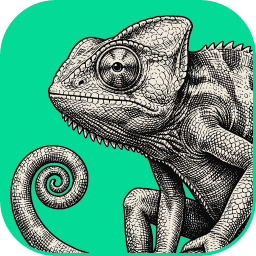
</p>

<h1 align="center">FigCraft</h1>

<p align="center">
  <b>Desain antarmuka dan pembuatan prototipe: sumber terbuka, kolaboratif, dan dibangun sepenuhnya dengan Rust.</b><br>
  Frame, auto layout, komponen dan varian, jaringan vektor, gaya, variabel, dan prototipe,<br>
  dalam aplikasi native yang terbuka seketika dan berjalan luring. Sumber terbuka, dan milik Anda.
</p>

<p align="center">
  
  
  
  
  <br>
  <a href="https://sonarcloud.io/project/overview?id=storytold_figcraft"></a>
  <a href="https://coderabbit.ai"></a>
</p>

<p align="center">
  <a href="https://discord.gg/artcraft"></a>
</p>

<p align="center">
  <a href="https://getartcraft.com/apps/figcraft"><b>FigCraft di getartcraft.com</b></a> ·
  <a href="https://getartcraft.com/">ArtCraft</a> ·
  <a href="https://getartcraft.com/apps">Semua Aplikasi Crafting</a>
</p>

<br>

<p align="center">
  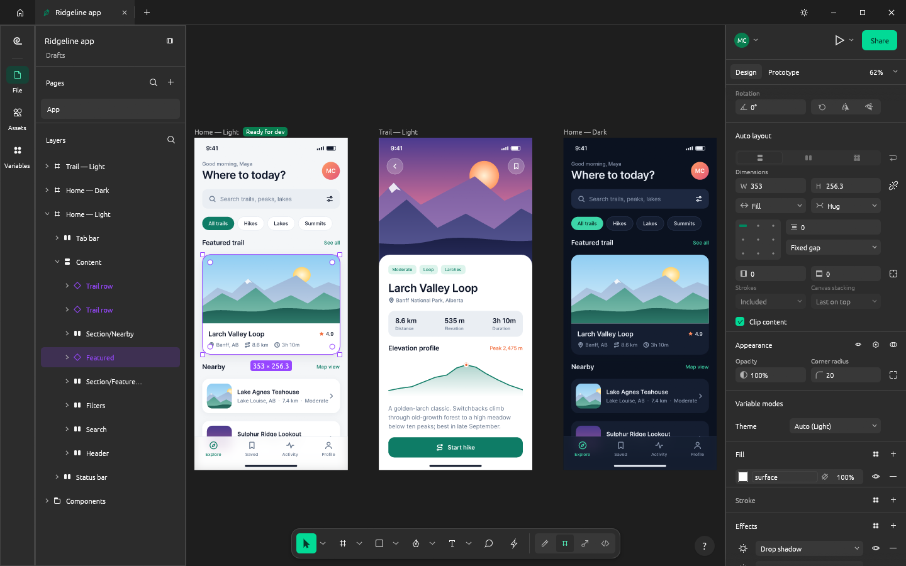
  <br><sub><b>Ridgeline</b>: layar auto layout yang dibangun dari komponen, dengan mode Terang dan Gelap dari satu set variabel warna · <code>examples/ridgeline-app.figcraft</code></sub>
</p>

<br>

> [!NOTE]
> **ArtCraft adalah komunitas para kreator dari berbagai latar belakang.** Desainer, ilustrator, developer,
> musisi, pembuat gim &mdash; jika Anda suka berkarya, Anda adalah bagian dari kami. **[Sapa kami di Discord](https://discord.gg/artcraft).**

<p align="center">
  <a href="#sekilas-pandang">Sekilas pandang</a> ·
  <a href="#dibuat-di-figcraft">Dibuat di FigCraft</a> ·
  <a href="#fitur">Fitur</a> ·
  <a href="#dirancang-untuk-agen">Agen</a> ·
  <a href="#di-balik-layar">Di balik layar</a> ·
  <a href="#memulai">Memulai</a> ·
  <a href="#aplikasi-crafting">Aplikasi Crafting</a> ·
  <a href="https://discord.gg/artcraft">Discord</a>
</p>

<br>

<table>
  <tr>
    <td width="25%" valign="top">
      <h3>🎛️ Terasa familier</h3>
      Toolbar, panel lapisan, panel Desain, menu, dan pintasan keyboard berada tepat di tempat yang biasa Anda gunakan.
    </td>
    <td width="25%" valign="top">
      <h3>⚡ Native dan cepat</h3>
      Mesin Rust dengan model dokumen persisten: suntingan hanya menyentuh bagian yang berubah, sehingga membuat node pada berkas berisi 20.000 node hanya memakan waktu sepersekian milidetik. Tanpa Electron, tanpa web view.
    </td>
    <td width="25%" valign="top">
      <h3>🔌 Luring dan privat</h3>
      Berkas Anda tersimpan sebagai arsip <code>.figcraft</code> biasa di penyimpanan lokal Anda. Tanpa akun, tanpa telemetri, dan tidak ada data yang keluar dari komputer Anda kecuali Anda membagikan berkas (<a href="#privasi-dan-berbagi-daring">detail pengiriman data saat berbagi</a>). Mendukung impor dan ekspor SVG, PNG, JPG, WebP, dan PDF; berkas <code>.fig</code> dapat dibuka (upaya terbaik/<i>best effort</i>), begitu pula desain yang diekspor dalam format JSON REST API publik beserta prototipe dan variabelnya.
    </td>
    <td width="25%" valign="top">
      <h3>🤖 Siap untuk agen</h3>
      Setiap item menu, alat, dan seretan tetikus merupakan perintah, sehingga mesin yang sama dapat dijalankan dari antarmuka pengguna (UI), CLI, kanal kontrol JSON, atau server MCP.
    </td>
  </tr>
</table>

<br>

## Sekilas pandang

<table>
<tr>
<td width="50%" valign="top">
  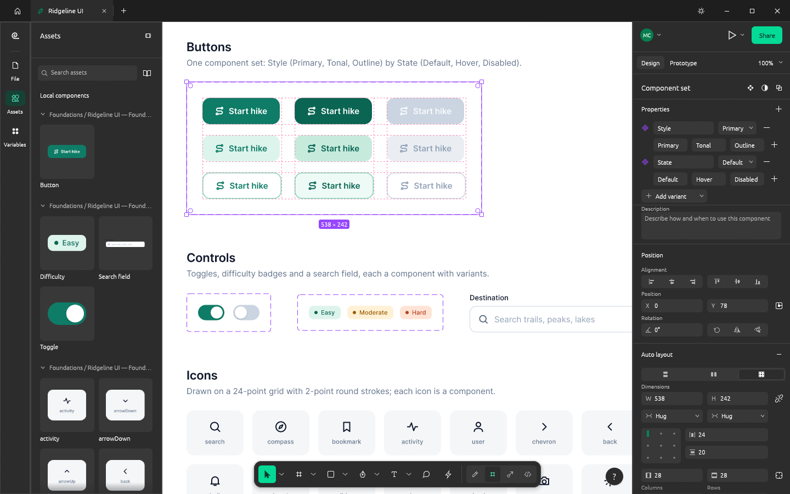
  <p align="center"><sub><b>Komponen dan varian</b>: kumpulan komponen, properti varian, dan panel Aset · <code>examples/ridgeline-design-system.figcraft</code></sub></p>
</td>
<td width="50%" valign="top">
  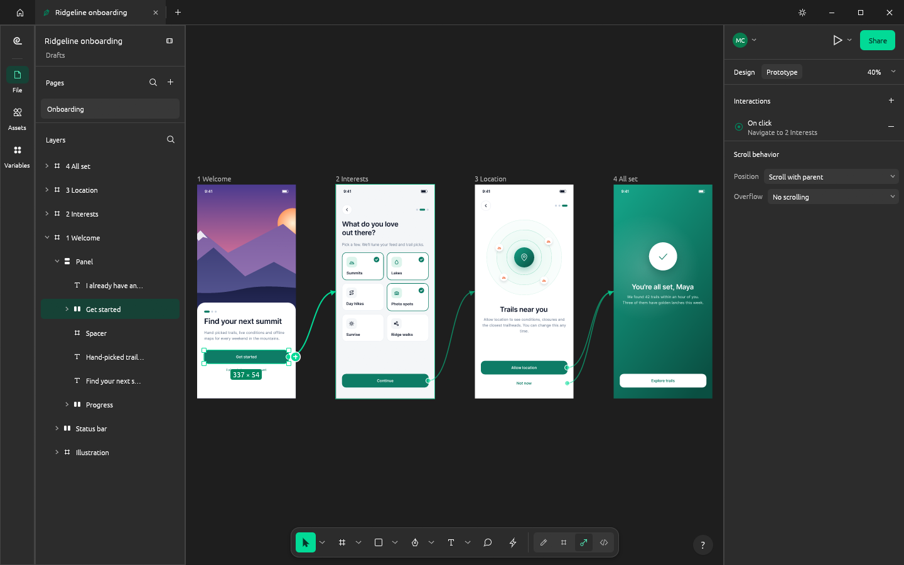
  <p align="center"><sub><b>Pembuatan prototipe</b>: koneksi, transisi, aksi kembali, dan alur (flow) · <code>examples/ridgeline-onboarding.figcraft</code></sub></p>
</td>
</tr>
<tr>
<td width="50%" valign="top">
  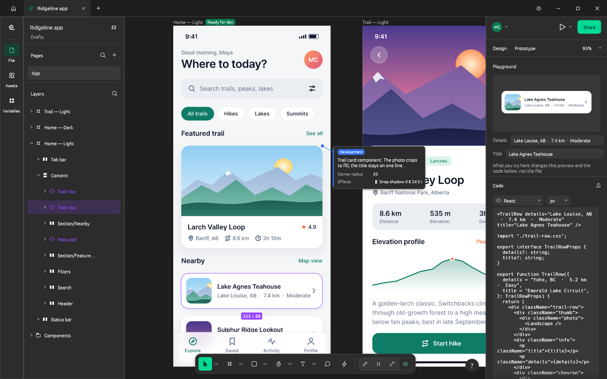
  <p align="center"><sub><b>Mode Pengembang</b>: status siap untuk pengembangan, catatan, dan kode React dengan properti komponen menjadi props · <code>examples/ridgeline-app.figcraft</code></sub></p>
</td>
<td width="50%" valign="top">
  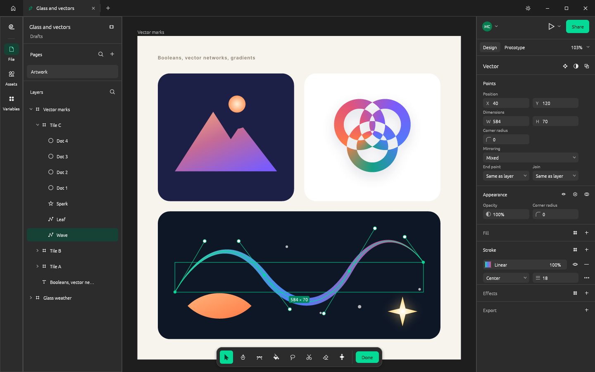
  <p align="center"><sub><b>Jaringan vektor</b>: titik dan pegangan, garis tepi berlebar variabel, serta operasi boolean yang tetap dapat disunting · <code>examples/glass-and-vectors.figcraft</code></sub></p>
</td>
</tr>
<tr>
<td width="50%" valign="top">
  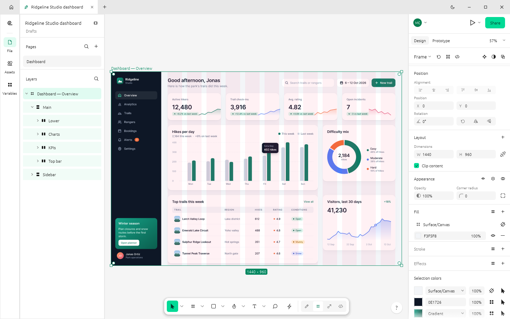
  <p align="center"><sub><b>Grid tata letak dan gaya, tema terang</b>: grid 12 kolom, gaya warna, teks, efek, dan grid, serta grafik yang digambar dari bentuk · <code>examples/ridgeline-studio-dashboard.figcraft</code></sub></p>
</td>
<td width="50%" valign="top">
  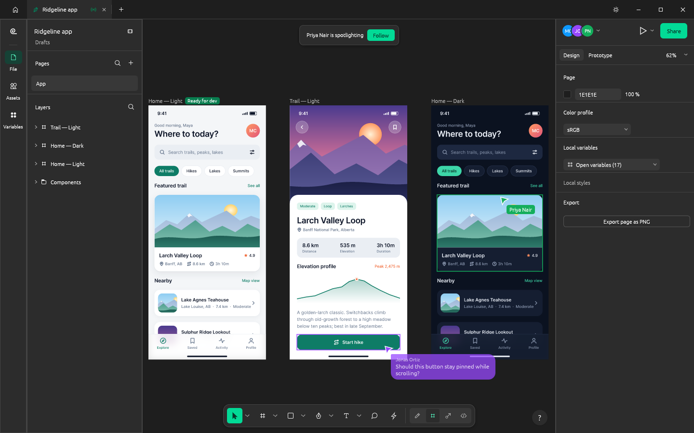
  <p align="center"><sub><b>Sesi langsung</b>: tiga aplikasi pada satu berkas <code>figcraft-server</code>, lengkap dengan kursor, seleksi, obrolan kursor, dan sorotan (spotlight)</sub></p>
</td>
</tr>
<tr>
<td width="50%" valign="top">
  
  <p align="center"><sub><b>Papan tulis (Boards)</b>: jenis berkas papan tulis dengan catatan tempel, templat, konektor, pewaktu bersama, dan pemungutan suara, dalam sesi langsung yang sama</sub></p>
</td>
<td width="50%" valign="top">
  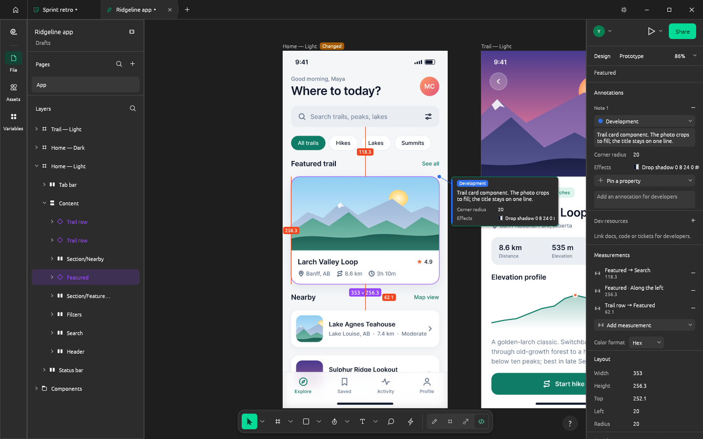
  <p align="center"><sub><b>Pengukuran Mode Pengembang</b>: garis ukur di antara lapisan atau di sepanjang sisi, tersimpan dalam berkas dan mengikuti perubahan lapisan · <code>examples/ridgeline-app.figcraft</code></sub></p>
</td>
</tr>
</table>

## Dibuat di FigCraft

Setiap desain di bawah ini dibangun sepenuhnya melalui API perintah FigCraft—API yang sama yang
diekspos server MCP ke agen—dan diekspor pada skala 2x oleh perender bawaan FigCraft. Berkas
sumbernya tersedia di [`examples/`](examples).

<table>
<tr>
<td width="33%" valign="top">
  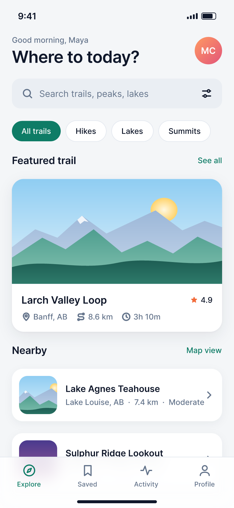
  <p align="center"><sub><b>Beranda, terang</b></sub></p>
</td>
<td width="33%" valign="top">
  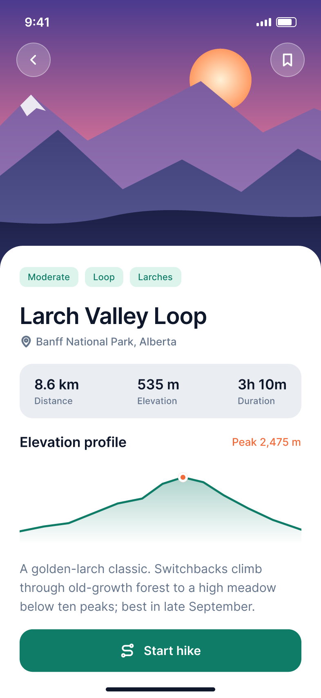
  <p align="center"><sub><b>Detail jalur</b></sub></p>
</td>
<td width="33%" valign="top">
  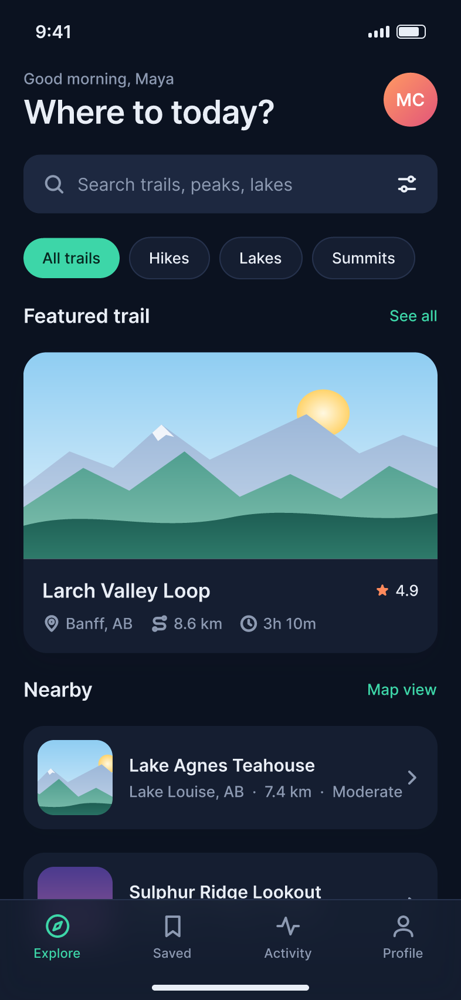
  <p align="center"><sub><b>Beranda, gelap</b>: frame yang sama dalam mode Dark</sub></p>
</td>
</tr>
<tr>
<td colspan="3" valign="top">
  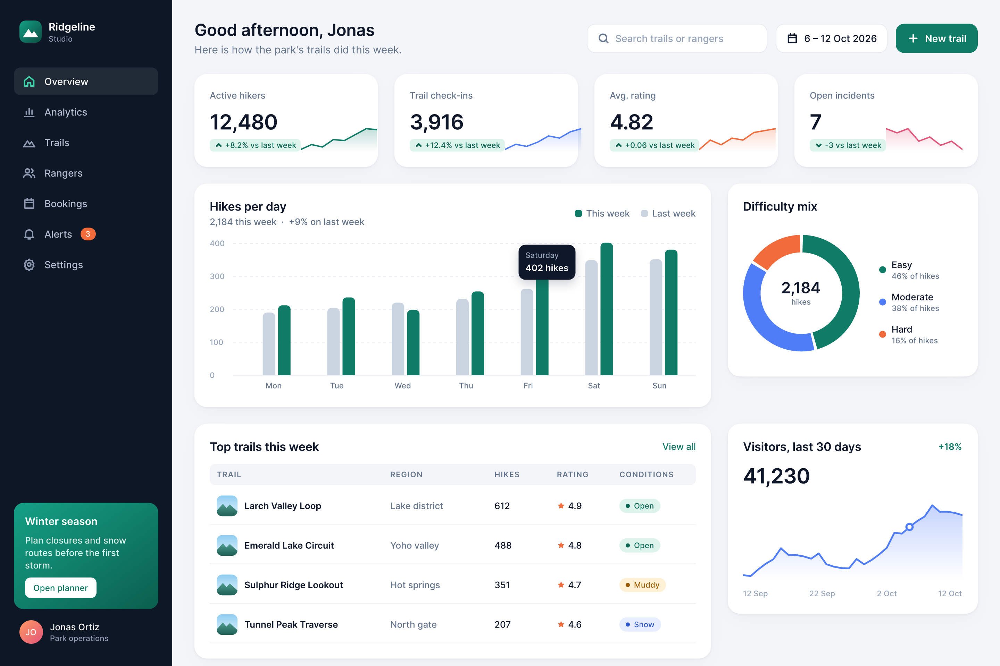
  <p align="center"><sub><b>Ridgeline Studio</b>: dasbor desktop di atas grid 12 kolom, setiap grafik dibuat dari bentuk dan vektor</sub></p>
</td>
</tr>
<tr>
<td colspan="2" valign="top">
  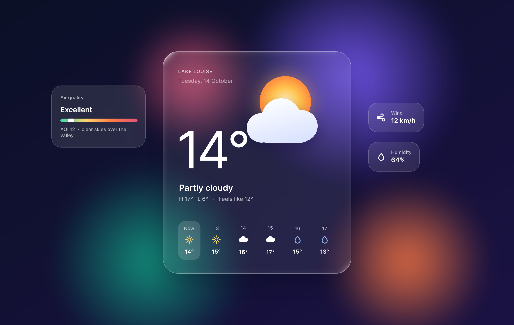
  <p align="center"><sub><b>Cuaca kaca</b>: efek kaca dan buram latar belakang, bidang warna dengan layer blur, serta awan gabungan boolean</sub></p>
</td>
<td width="33%" valign="top">
  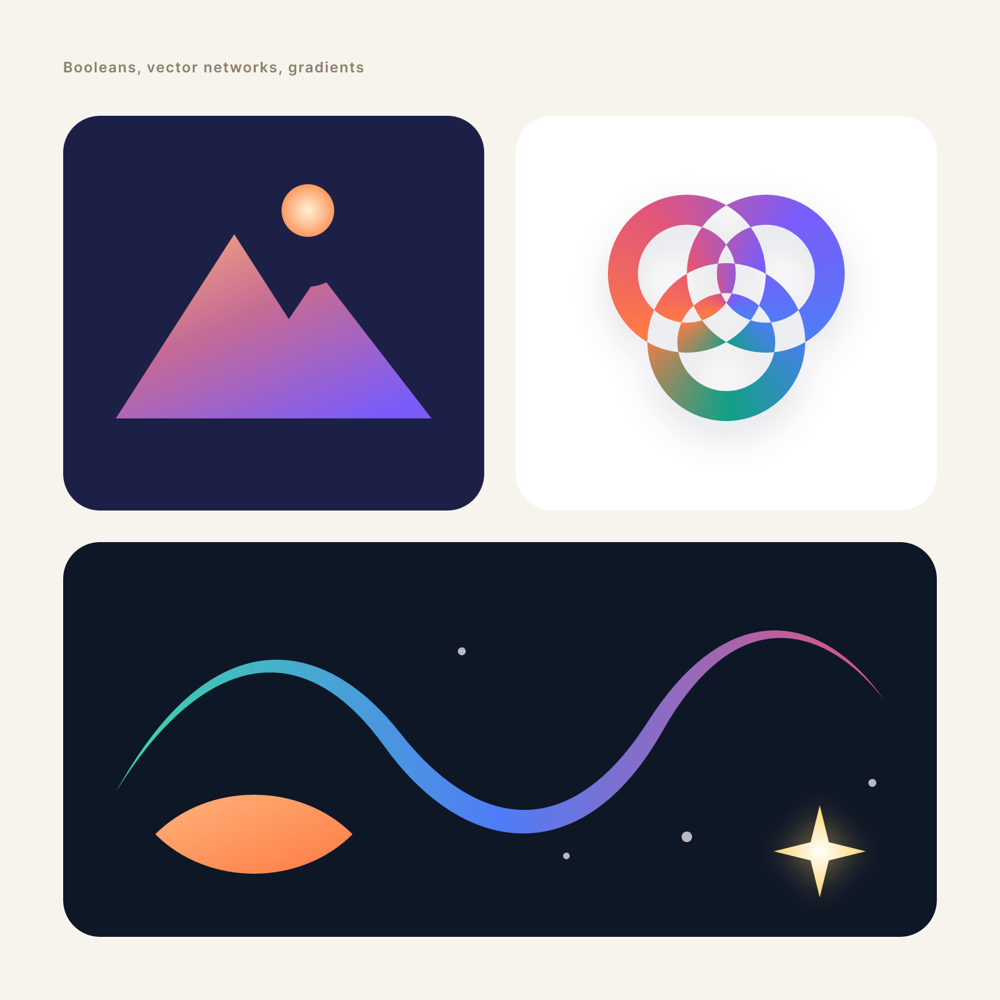
  <p align="center"><sub><b>Mark vektor</b>: union, subtract, dan exclude, gradien sudut, serta garis tepi berlebar variabel</sub></p>
</td>
</tr>
<tr>
<td colspan="3" valign="top">
  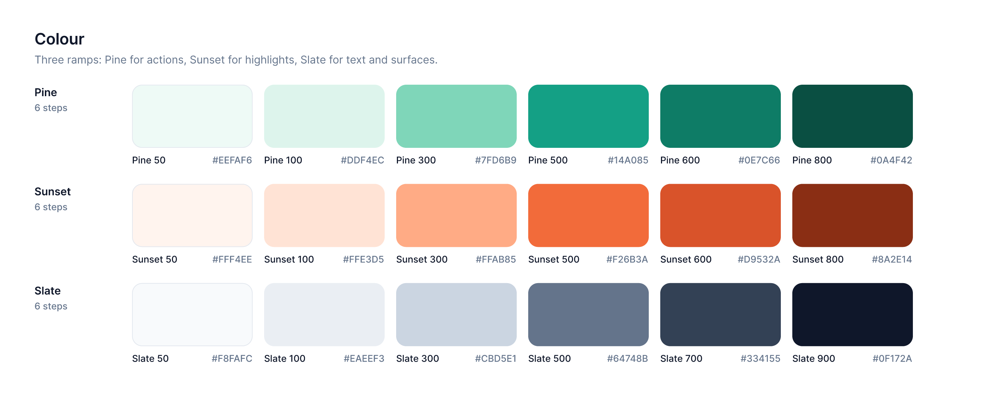
  <p align="center"><sub><b>Ridgeline UI</b>: gradasi warna tempat setiap sampel menjadi gaya warna, diekspor melalui slice</sub></p>
</td>
</tr>
</table>

## Fitur

<table>
  <tr>
    <td width="50%" valign="top">
      <h3>Tata letak yang menyusun dirinya sendiri</h3>
      Auto layout dua arah, dengan wrap dan grid (trek berukuran tetap/fixed, hug, dan <code>fr</code>, serta sel yang dapat membentang/span), padding, jarak antar-elemen (gap), perataan termasuk baseline teks, ukuran Hug / Fill / Fixed, batas ukuran minimum dan maksimum, pemosisian absolut, pegangan seret untuk padding dan jarak langsung di kanvas, serta tombol panah untuk memindahkan elemen anak melintasi alur, sel grid, dan frame bersarang. Gunakan constraints dan grid tata letak untuk kebutuhan lainnya.
    </td>
    <td width="50%" valign="top">
      <h3>Komponen yang mudah diskalakan</h3>
      Komponen utama (main component), instans dengan override yang tetap bertahan saat desain disunting, kumpulan komponen dengan varian, properti, tukar instans (swap instance), lepas (detach), atur ulang override (reset overrides), dan lompat ke komponen utama, serta panel Aset dengan pratinjau langsung, pencarian, dan seret-ke-kanvas ke dalam frame maupun auto layout. Gaya lokal dan variabel (warna, angka, string, boolean) dengan mode, alias, dan cakupan (scope), yang disunting dalam tabel Variabel serta dihubungkan ke isian, garis tepi, efek, grid tata letak, dan properti instans. Isian, garis tepi, efek, dan grid tata letak dapat diurutkan ulang dengan menyeret barisnya.
    </td>
  </tr>
  <tr>
    <td width="50%" valign="top">
      <h3>Vektor tanpa kompromi</h3>
      Jaringan vektor sejati: alat Pen dan Pencil, mode sunting vektor dengan alat khususnya sendiri (pen yang memperpanjang dan mencabangkan jalur, bend, paint bucket untuk mengisi area tertutup mana pun, lasso, cut), panel titik dengan pencerminan pegangan dan radius sudut per titik, gabung (join), pisahkan (split), dan pulihkan saat dihapus (heal-on-delete), shape builder (klik atau seret melintasi area bentuk yang tumpang tindih, garis tepi, dan jalur terbuka untuk menggabungkannya, atau tekan Alt untuk menghapusnya), grup boolean (union, subtract, intersect, exclude) yang operand-nya tetap dapat disunting di kanvas dengan hasil yang mengikuti setiap seretan, satu operasi per operand, flatten, outline stroke, kepala panah (arrowheads), garis putus-putus, garis tepi per sisi, serta garis tepi berlebar variabel (preset profil lebar, dan alat Variable width yang menyeret titik lebar di sepanjang jalur, satu sisi per waktu dengan Alt). Persegi panjang dengan sudut halus (squircle), poligon, bintang, serta busur (arc) dan cincin yang dibentuk melalui pegangan sweep, start, dan ratio di kanvas atau kolom Arc di panel Desain.
    </td>
    <td width="50%" valign="top">
      <h3>Warna isian (paints) dan efek</h3>
      Gradien solid, linear, radial, angular, dan diamond dengan pegangan langsung di kanvas, isian gambar (fill, fit, crop, tile) lengkap dengan penyesuaian dan preset, banyak isian dan garis tepi sekaligus, semua mode blending, bayangan jatuh (drop shadow) dan bayangan dalam (inner shadow) dengan spread yang menggeser garis batas secara presisi, layer blur dan background blur (merata atau bertahap/progressive), noise (mono, duo, multi), tekstur serta efek kaca (refraksi, dispersi, frost, cahaya), dan mask. Berkas mendukung ruang warna sRGB atau Display P3, dengan hasil ekspor yang diberi tanda profil warna berkas.
    </td>
  </tr>
  <tr>
    <td width="50%" valign="top">
      <h3>Tipografi yang tertata rapi</h3>
      Teks disunting langsung di tempat pada kanvas (dengan komposisi IME inline), gaya campuran dalam satu paragraf, lebar otomatis dan tinggi otomatis, tinggi baris, jarak antar-huruf dan antar-paragraf, dekorasi, kapitalisasi, daftar (list), fitur OpenType, sumbu font variabel (variable font axes), dan gaya teks, teks kanan-ke-kiri serta teks dua arah campuran (Arab, Ibrani) dengan algoritma bidi Unicode, yang dibentuk menggunakan HarfRust dan font terbuka dari craft-fonts maupun font sistem Anda.
    </td>
    <td width="50%" valign="top">
      <h3>Prototipe dan serah terima (hand off)</h3>
      Koneksi, pemicu (trigger), aksi, dan transisi bergaya Smart Animate, variabel dengan logika kondisional (if / else if / else built-in di editor interaksi, ekspresi seperti <code>count + 1</code>), alur (flow), tampilan presentasi dengan bingkai perangkat, petunjuk hotspot, dan panel Inspect, serta panel pratinjau langsung. Tekan Alt untuk mengukur jarak dan padding di kanvas, mode Inspect dengan pengukuran, catatan berkategori warna, daftar siap untuk pengembangan (ready-for-dev) dengan tampilan fokus dan Compare changes (sebelum/sesudah dengan perbedaan tingkat properti sejak frame ditandai siap), serta kode (CSS, HTML, React, Vue, Leptos, SwiftUI, Compose, ArkUI, Flutter) tempat komponen menerima propertinya sebagai parameter, utas komentar yang tersemat pada frame (balasan, @mention, reaksi, status terbaca), dan riwayat versi bernama. Ekspor lapisan apa pun ke skala berapa pun dalam format PNG, JPG, WebP, SVG, atau PDF.
    </td>
  </tr>
</table>

<br>

## Dirancang untuk agen

Setiap item menu, alat, dan gestur menjalankan perintah dari satu registri berisi lebih dari 400 perintah. UI, CLI, kanal kontrol JSON, dan server MCP semuanya memanggil perintah yang sama, sehingga apa pun yang bisa Anda klik juga bisa dijalankan oleh skrip atau agen AI.

```sh
# Mode headless: render dan ekspor
figcraft-cli render landing.figcraft -o landing.png --scale 2
figcraft-cli export landing.figcraft -o out/ --format svg

# Jalankan skrip perintah tanpa membuka jendela aplikasi
figcraft-cli run build-card.json --out card.figcraft

# Tampilkan setiap perintah beserta parameternya
figcraft-cli commands --filter autoLayout

# Jalankan agen melalui MCP (headless, atau terhubung ke aplikasi yang sedang berjalan)
figcraft-cli mcp
figcraft-cli mcp --attach 47800
```

Aplikasi desktop juga menyediakan kanal kontrol khusus loopback (`figcraft --control <port>`) untuk memeriksa status UI, menggerakkan alat menggunakan event pointer dan keyboard, serta mengambil tangkapan layar. Lihat [`docs/control-protocol.md`](docs/control-protocol.md), [`docs/mcp.md`](docs/mcp.md), dan [`docs/cli.md`](docs/cli.md).

## Di balik layar

- **Mesin sebagai inti:** model dokumen berbasis data murni dan mesin perintah, dengan UI `egui` yang ringan dan dapat diganti. Pelapisan arsitektur diperiksa saat kompilasi di seluruh crate workspace (`cargo xtask layers`).
- **Data persisten:** dokumen tersimpan dalam peta terurut yang imutabel (immutable ordered map), sehingga snapshot undo hemat memori dan perhitungan tata letak, sinkronisasi komponen, serta pengukuran teks hanya memproses ulang bagian yang berubah.
- **Perender mandiri:** menggunakan `tiny-skia` di seluruh inti untuk kanvas dan ekspor, lengkap dengan blending lapisan, efek, dan mask; operasi boolean dari `linesweeper`, geometri dari `kurbo`, serta teks dari `skrifa` dan `HarfRust`.
- **Berjalan di peramban:** seluruh mesin dan UI dapat dikompilasi ke WebAssembly.
- **Aksesibel:** pembaca layar (screen reader) memperoleh nama, peran, nilai, dan status untuk berbagai alat, baris lapisan, kolom isian, dropdown, tab, dan menu (AccessKit di desktop); `F6` memindahkan fokus keyboard di antara toolbar, lapisan, kanvas, dan properti (`Tab` di dalam masing-masing area, `Escape` untuk kembali ke kanvas); pengaturan kurangi gerak (reduce-motion) pada sistem dihormati; dan teks panel memenuhi kontras WCAG AA pada kedua tema.
- **Bahasa:** Inggris, Rusia, dan Turki (ditinjau oleh penutur asli), serta draf bahasa Spanyol, Prancis, Jerman, Portugis Brasil, Jepang, Korea, Mandarin Sederhana, Ceko, Indonesia, Georgia, Vietnam, dan Bosnia, yang dapat dipilih di Preferences atau diambil otomatis dari sistem/peramban dan diganti secara langsung; menambah bahasa cukup dengan satu berkas katalog ([`docs/translating.md`](docs/translating.md)).
- **Plugin:** plugin WebAssembly terisolasi (interpreter Rust murni yang terukur dengan batas memori serta tanpa akses berkas maupun jaringan, berlaku juga di peramban) yang bekerja melalui perintah yang sama, masing-masing berjalan dalam satu langkah undo sesuai izin yang diminta pada manifesnya. SDK Rust dan empat contoh plugin tersedia di [`plugins/`](plugins); lihat [`docs/plugins.md`](docs/plugins.md).
- **Sesi langsung (pratinjau):** bagikan berkas yang sedang terbuka langsung dari aplikasi (Share ▸ Start sharing: daring melalui server atau lewat jaringan lokal), berikan kode gabung singkat yang muncul (atau tautan undangan) kepada rekan Anda, dan sunting bersama: perubahan semua orang tersinkronisasi secara langsung, lengkap dengan kursor, seleksi, avatar, dan fitur ikuti (follow), sementara undo hanya membatalkan perubahan milik Anda sendiri. Rekan lain dapat bergabung lewat aplikasi desktop (tautan undangan akan membukanya) atau lewat versi peramban. Lihat [`docs/collab-protocol.md`](docs/collab-protocol.md).
- **Server mandiri (pratinjau):** `figcraft-server` menyimpan berkas tim, memublikasikannya dari aplikasi (File ▸ Publish to server…, atau Share ▸ Online with your server di Preferences), serta membagikan tautan berbagi dan kode gabung untuk akses sunting atau lihat saja; berkas tetap ada setelah mulai ulang (restart) dan aplikasi akan terhubung kembali ke posisi terakhir. Belum ada sistem akun: tautan menjadi akses masuk. Rilis resmi menyediakannya untuk Linux dan aplikasi desktop terhubung lewat `wss://`; [menghostingnya di server Linux sewaan](docs/server.md#deploy-on-a-linux-server) hanya memerlukan unit systemd dan Caddy atau nginx (atau Docker). Lihat [`docs/server.md`](docs/server.md).
- **Anti-crash:** tanpa `unwrap`, `expect`, atau `panic` pada kode rilis, yang ditegakkan oleh clippy; perintah berjalan di balik pengaman agar bug hanya menggagalkan satu aksi, bukan sesi Anda.
- **Clean-room:** implemented secara murni dari dokumentasi publik dan perilaku yang teramati. Tidak menggunakan kode, format berkas, ikon, maupun gambar berhak cipta/proprietari.

## Memulai

```sh
git clone https://github.com/storytold/figcraft
cd figcraft
cargo run --release -p figcraft            # aplikasi desktop
cargo run --release -p figcraft-server     # server kolaborasi (docs/server.md)
cargo test --workspace                     # rangkaian pengujian
cargo xtask ci                             # pemeriksaan fmt, clippy, tes, pelapisan, dan aset
```

Font untuk UI dan alat Teks berasal dari [craft-fonts](https://github.com/storytold/craft-fonts), yang di-clone di sebelah repositori ini (`../craft-fonts`); tanpa repositori tersebut, FigCraft akan beralih ke font sistem Anda.

```sh
git clone https://github.com/storytold/craft-fonts ../craft-fonts
```

Jika Anda melakukan clone setelah build pertama, jalankan `cargo clean -p figcraft-text` satu kali agar build berikutnya menyematkan font tersebut.

**Mulai dari templat.** Tab Templates di layar beranda menyediakan delapan berkas awal (aplikasi seluler, landing page, dasbor, starter sistem desain, wireframe kit, ukuran unggahan media sosial, slide presentasi, dan starter paket ikon), yang juga dapat diakses lewat File ▸ New from template…. Templat ini dibentuk melalui kode dari konten sintetis orisinal, sehingga skrip dan agen juga dapat membukanya: `file.newFromTemplate {template}` ([`docs/mcp.md`](docs/mcp.md#starter-templates)).

Untuk build web, instal [trunk](https://trunkrs.dev/) lalu jalankan `cargo xtask wasm`.

Bagi kontributor baru dan agen AI: mulailah dari [`AGENTS.md`](AGENTS.md), lalu lanjutkan ke [`docs/`](docs/).

Installer untuk macOS (universal, bertanda tangan digital, dan ter-notarisasi), Windows (x64, x86, dan arm64), Linux (AppImage, `.deb`, `.rpm`, Flatpak, dan tarball), FreeBSD, serta web dilampirkan pada setiap [rilis GitHub](https://github.com/storytold/figcraft/releases). Untuk maintainer: [`docs/releasing.md`](docs/releasing.md) menjelaskan cara build, penandatanganan, dan publikasi rilis.

> [!IMPORTANT]
> **Status:** FigCraft masih berada pada tahap **alfa**: sekitar 49% menuju kemampuan menggantikan perangkat lunak berbayar untuk pekerjaan nyata, menurut perkiraan kami sendiri. Hampir seluruh aksi desain antarmuka yang tercatat pada daftar periksa menu sudah terhubung ([`docs/parity-checklist.md`](docs/parity-checklist.md)) dan editor inti sudah berjalan menyeluruh, namun FigCraft membuka berkas `.fig` sebatas upaya terbaik (best effort), baru memiliki pratinjau awal fitur multipemain (sesi langsung yang dihosting dari aplikasi atau server mandiri, dengan undo per orang serta tautan berbagi untuk menyunting atau melihat; belum ada akun, tim, maupun cloud), menjalankan plugin WebAssembly miliknya sendiri, dan belum diuji terhadap dokumen desain dunia nyata. Gambaran jujur per bagian tersedia di [roadmap](ROADMAP.md) dan [`docs/target-app-parity.md`](docs/target-app-parity.md). Masih mungkin ada bagian yang kurang mulus—silakan laporkan issue atau beri tahu kami kendala yang Anda temui di [Discord](https://discord.gg/artcraft).

## Privasi dan berbagi daring

FigCraft dapat bekerja secara luring: aplikasi ini tidak memiliki akun dan telemetri, serta tidak menghubungi server mana pun sampai Anda membagikan atau bergabung ke sebuah berkas. Sesi langsung masih berupa **pratinjau**. Sebelum membagikan sesuatu yang penting, pahami dampak dari fitur berbagi berikut:

- **Share ▸ Online mengunggah berkas ke server.** Secara bawaan, server yang digunakan adalah server publik di `collab.craftapps.dev`; Anda dapat mengatur server lain atau server milik Anda sendiri di Preferences (dan sebuah build dapat dirilis tanpa server bawaan: [`docs/releasing.md`](docs/releasing.md#the-default-server)). Berkas tetap berada di server setelah Anda berhenti berbagi, hingga Anda menghapusnya (Share ▸ Advanced ▸ Remove from server…) atau tidak ada yang membukanya selama 30 hari, saat server publik akan menghapusnya.
- **Tidak terenkripsi ujung-ke-ujung (end-to-end encrypted).** Koneksi ke server terenkripsi (TLS), tetapi server menyimpan berkas tanpa enkripsi dan siapa pun yang mengelola server dapat membacanya. Jangan bagikan pekerjaan yang bersifat rahasia melalui server yang tidak Anda percayai; jalankan server Anda sendiri ([`docs/server.md`](docs/server.md)) atau bagikan melalui jaringan lokal saja.
- **Kode atau tautan adalah aksesnya.** Tidak ada sistem akun: siapa pun yang memiliki kode atau tautan sunting dapat membuka dan mengubah berkas, dan siapa pun yang memiliki kode atau tautan lihat dapat membukanya. Menghentikan berbagi akan mencabut akses tersebut dan memutus koneksi peserta lain.
- **Share ▸ Local network tidak menggunakan server**, tetapi koneksinya juga tidak terenkripsi: aplikasi Anda menjadi host sesi dan peserta lain terhubung langsung ke perangkat Anda, jadi gunakan hanya pada jaringan yang Anda percayai.
- **Tanpa jaminan.** Server publik disediakan apa adanya, tanpa jaminan pencadangan (backup) maupun uptime, dan berkas di dalamnya dapat dihapus. Simpan salinan cadangan Anda sendiri untuk setiap berkas yang Anda bagikan.

Ketentuan server bawaan dapat dibaca di [`docs/online-sharing-terms.md`](docs/online-sharing-terms.md).

## Aplikasi Crafting

FigCraft adalah salah satu dari **Aplikasi Crafting**: perangkat lunak kreatif gratis dan sumber terbuka dari tim [ArtCraft](https://getartcraft.com/), yang masing-masing ditulis dari awal menggunakan Rust dan dapat berdiri sendiri.

| | Aplikasi | Kegunaan | Kode | Info lanjut |
|:-:|---|---|---|---|
|  | **PhotoCraft** | Penyuntingan gambar: lapisan, mask, tipografi, dan berkas PSD asli | [GitHub](https://github.com/storytold/photocraft) | [Situs Web](https://getartcraft.com/apps/photocraft) |
|  | **VectorCraft** | Ilustrasi vektor | [GitHub](https://github.com/storytold/vectorcraft) | [Situs Web](https://getartcraft.com/apps/vectorcraft) |
|  | **FilmCraft** | Penyuntingan video, warna, dan suara | [GitHub](https://github.com/storytold/filmcraft) | [Situs Web](https://getartcraft.com/apps/filmcraft) |
|  | **LightCraft** | Pustaka foto dan pemrosesan RAW | [GitHub](https://github.com/storytold/lightcraft) | [Situs Web](https://getartcraft.com/apps/lightcraft) |
|  | **PdfCraft** | Membaca, menata, dan melindungi PDF | [GitHub](https://github.com/storytold/pdfcraft) | [Situs Web](https://getartcraft.com/apps/pdfcraft) |
|  | **EffectCraft** | Motion graphics dan efek visual | [GitHub](https://github.com/storytold/effectcraft) | [Situs Web](https://getartcraft.com/apps/effectcraft) |
|  | **DesignCraft** | Tata letak halaman dan penerbitan | [GitHub](https://github.com/storytold/designcraft) | [Situs Web](https://getartcraft.com/apps/designcraft) |
|  | **FigCraft** | Desain antarmuka dan pembuatan prototipe | [GitHub](https://github.com/storytold/figcraft) | [Situs Web](https://getartcraft.com/apps/figcraft) |
|  | **WordCraft** | Pengolahan kata dan dokumen | [GitHub](https://github.com/storytold/wordcraft) | [Situs Web](https://getartcraft.com/apps/wordcraft) |
|  | **SoundCraft** | Perekaman dan penyuntingan audio | [GitHub](https://github.com/storytold/soundcraft) | [Situs Web](https://getartcraft.com/apps/soundcraft) |
|  | **DeckCraft** | Presentasi dan slide | [GitHub](https://github.com/storytold/deckcraft) | [Situs Web](https://getartcraft.com/apps/deckcraft) |
|  | **CADCraft** | Desain berbantuan komputer (CAD) | [GitHub](https://github.com/storytold/cadcraft) | [Situs Web](https://getartcraft.com/apps/cadcraft) |
|  | **GridCraft** | Spreadsheet dan data | [GitHub](https://github.com/storytold/gridcraft) | [Situs Web](https://getartcraft.com/apps/gridcraft) |
|  | **TextureCraft** | Melukis tekstur 3D | [GitHub](https://github.com/storytold/texturecraft) | [Situs Web](https://getartcraft.com/apps/texturecraft) |
|  | **Craft Anything** | Pelajari cara kerja perangkat lunak apa pun, lalu bangun milik Anda sendiri | [GitHub](https://github.com/storytold/craft-anything) | [Website](https://getartcraft.com/apps/craft-anything) |
|  | **SolidCraft** | CAD 3D parametrik oleh Tangency Labs (aplikasi komunitas) | [GitHub](https://github.com/tangency-labs/solidcraft) | |

Dan [**ArtCraft**](https://getartcraft.com/) itu sendiri, studio gambar dan video AI kami bagi kreator yang menginginkan kendali penuh.

Aplikasi Crafting berbagi prinsip yang sama: clean-room dan murni Rust, native di macOS, Windows, Linux, dan FreeBSD, berjalan di peramban melalui WebAssembly, serta sepenuhnya dapat dikendalikan oleh agen.

<br>

<p align="center">
  <a href="https://discord.gg/artcraft"></a>
</p>

<h3 align="center">Mari berkarya bersama kami</h3>

<p align="center">
  Discord kami adalah tempat berkumpulnya para kreator: desainer yang sedang membuat sketsa aplikasi pertamanya,
  developer yang ingin tombol tampil pas, ilustrator, pembuat film, pegiat tipografi, hingga
  banyak orang yang masih mencari tahu karya apa yang ingin dibuat. Bagikan proyek yang sedang Anda kerjakan, minta
  bantuan, beri tahu kami jika ada bagian yang rusak atau fitur yang Anda harapkan ada di FigCraft. Anda disambut dengan hangat di sini.
</p>

<p align="center">
  <a href="https://discord.gg/artcraft"><b>discord.gg/artcraft</b></a> ·
  <a href="https://getartcraft.com/">getartcraft.com</a> ·
  <a href="https://getartcraft.com/apps">Aplikasi Crafting</a> ·
  <a href="https://getartcraft.com/apps/figcraft">FigCraft</a>
</p>

---

## Lisensi dan kredit

FigCraft menggunakan lisensi ganda [MIT](LICENSE-MIT) atau [Apache-2.0](LICENSE-APACHE), sesuai pilihan Anda.
Hak cipta (c) 2026 Tim ArtCraft dan para kontributor FigCraft. Pemberitahuan yang diwajibkan tercantum pada [NOTICE](NOTICE).

Setiap ikon di FigCraft digambar melalui kode atau dibuat khusus untuk proyek ini, sedangkan font bawaan, gambar, serta aset lainnya mempertahankan lisensi terbuka masing-masing; setiap aset dicantumkan beserta pembuat, sumber, dan lisensinya di [ATTRIBUTION.md](ATTRIBUTION.md).

Nama ArtCraft, wordmark, dan logo yang ada di [`docs/brand/`](docs/brand/) merupakan merek dagang milik Tim ArtCraft dan tidak tercakup dalam lisensi ini. Aset tersebut hanya boleh digunakan tanpa diubah, dan hanya sebagai bagian dari repositori ini serta FigCraft, berdasarkan [`docs/brand/LICENSE-brand.txt`](docs/brand/LICENSE-brand.txt). Fork dan versi modifikasi wajib menghapusnya.

<p align="center">
  <a href="https://getartcraft.com/"></a><br>
  <sub>Dibuat oleh tim dan komunitas <a href="https://getartcraft.com/">ArtCraft</a>.</sub>
</p>

## Riwayat bintang (Star history)

[](https://www.star-history.com/?repos=storytold%2Ffigcraft&type=date&legend=top-left)